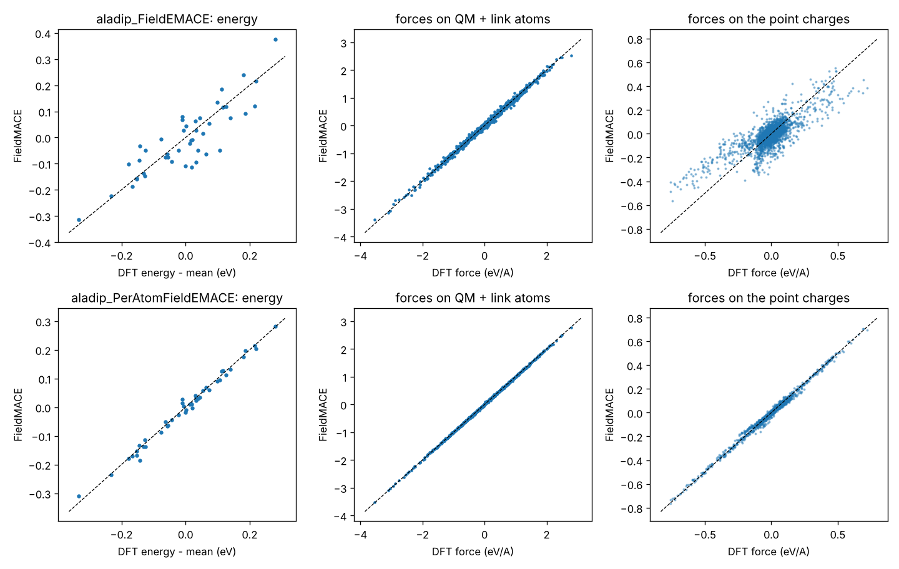

# Tutorial 01: QM/MM training data from any force field, and training

*Author: Rhyan Barrett*

You will

1. build a classical OpenMM system with any force field and choose a QM region (with link atoms),
2. sample configurations and write them in FieldMACE's format (QM atoms + MM point charges),
3. label them with DFT in the field of the point charges (PySCF),
4. train `PerAtomFieldEMACE` and `FieldEMACE`,
5. evaluate the models,
6. (optional) convert large data sets to HDF5.

The system is alanine dipeptide in water (Amber14/TIP3P). The QM region is the alanine side chain
CA, HA, CB, HB1, HB2, HB3, cut from the backbone at CA–N and CA–C.

```
01_prepare_system.py        -> work/system_classical.xml, work/setup.json, work/equilibrated.pdb
02_sample_configurations.py -> work/frames.xyz
03_label_with_pyscf.py      -> data/train.xyz, data/test.xyz, data/setup.json   (shipped as data/*.xyz.gz)
04_train.sh                 -> models/aladip_PerAtomFieldEMACE.model, models/aladip_FieldEMACE.model
05_evaluate.py              -> error table, results/parity_ground_state.png
06_hdf5.sh                  -> h5/, models/aladip_h5.model
```

The labelled data are included (`data/*.xyz.gz`, 300 frames, B3LYP/6-31G*), so you can start at step 4.
`04_train.sh` unpacks them.

---

## The QM/MM model in one paragraph

FieldMACE predicts the energy of the QM region **including** its electrostatic interaction with the MM
point charges, the number a QM code prints for a calculation with external charges. Everything else is
the force field:

```
E_total = E_FieldMACE(QM atoms + link atoms | MM point charges)
        + E_MM(MM–MM, bonded terms touching an MM atom, QM–MM Lennard-Jones)
```

To make this consistent, the same *embedding* must be used for the training data and the simulation. The
embedding covers which MM charges the QM region sees, where the link atoms sit, which charges near a link
are hidden, the cutoff and its switching function, and the coordinate origin. `mace.mlmm` keeps all of
this in one object, `EmbeddingFrame`, used both by the data exporter and by the OpenMM force. It is saved
to `setup.json`.

---

## Step 1: system and QM region

```bash
python 01_prepare_system.py                  # alanine dipeptide, Amber14, side chain as QM region
```

```
QM atoms: 8:ALA2-CA, 9:ALA2-HA, 10:ALA2-CB, 11:ALA2-HB1, 12:ALA2-HB2, 13:ALA2-HB3
added 8 X-H constraints outside the QM region
link atom: H on bond CA(8) - N(6), ratio 0.752
link atom: H on bond CA(8) - C(14), ratio 0.716
FieldMACE sees 8 atoms (Z = [6, 1, 6, 1, 1, 1, 1, 1]) and up to 2261 MM point charges
```

**Any force field.** The script calls `mace.mlmm.io.load_system`, which reads every format OpenMM reads:

```bash
python 01_prepare_system.py --prmtop sys.prmtop --inpcrd sys.inpcrd --qm "resname LIG"        # Amber
python 01_prepare_system.py --top topol.top --gro conf.gro --qm "resname LIG"                 # GROMACS, e.g. OPLS-AA
python 01_prepare_system.py --psf sys.psf --pdb sys.pdb --charmm-params par.prm top.rtf ...    # CHARMM
python 01_prepare_system.py --pdb sys.pdb --forcefield charmm36.xml charmm36/water.xml        # OpenMM ffxml
```

Nothing in FieldMACE inspects the force field beyond OpenMM's standard force classes. Bonded terms and
nonbonded parameters are found generically, including OPLS-style `RBTorsionForce` and
`CustomNonbondedForce` with geometric combination rules.

**Choosing the QM region (`--qm`).** Use `"index 8-13"` (0-based indices), `"resname LIG"` or `"resid 2"`,
combined with `or`. For anything fancier, compute the indices with MDTraj and pass `index`.

**Link atoms.** Every covalent bond between a QM and an MM atom gets a hydrogen on the bond:
`r_H = r_QM + ratio · (r_MM − r_QM)`. The ratio is a typical X–H distance over the force-field bond
length, so the H sits at a C–H distance. FieldMACE treats link atoms as ordinary H atoms. Their forces
are passed on to the QM and MM atoms through the chain rule, which happens automatically in the OpenMM
force. `--link-charge-scheme` decides which MM charges near the link the QM region does not see:

* `Z1` (default) hides the MM link host (here N and C of the backbone);
* `Z2` also hides its neighbours;
* `Z3` hides one more shell;
* `Z0` hides nothing.

Use the same scheme for data and simulation. `setup.json` takes care of that.

**Cutoff and switching (`--cutoff 8 --switch-width 2`).** FieldMACE sees MM charges within 8 Å of the
QM centroid. Charges between 6 and 8 Å are scaled smoothly to zero, so energies and forces stay
continuous when waters cross the cutoff. Without a cutoff (`--cutoff 0`) all charges are used. That is
fine for small systems, but for a solvated protein a cutoff keeps the QM calculations and the model
affordable. The number of charges changes from frame to frame; FieldMACE ≥ 2 needs no padding.

**Constraints.** The system is built without constraints. X–H constraints are then added only in the MM
region (`constrain_hbonds_except`), because FieldMACE describes all motions of the QM region. Use time
steps of 0.5–1 fs in ML/MM MD.

## Step 2: sampling

```bash
python 02_sample_configurations.py --n-frames 300 --stride-ps 0.5
```

Every frame is written with `frame_to_atoms`, which uses the same embedding as the simulation later:

| `atoms` | content |
|---|---|
| `positions` | QM atoms + link atoms, Å, centred on the QM centroid |
| `numbers` | elements (link atoms are H) |
| `info["mm_positions"]` | (M, 3) Å, every MM charge at its minimum image around the QM region |
| `info["mm_charges"]` | (M,) e, already multiplied by the switching function |
| `info["mm_indices"]`, `qm_indices`, `embedding` | bookkeeping, ignored by training |

Classical MD samples the force field's distribution. That is a good first data set. Afterwards, sample with
your first model (ML/MM MD) and add the frames the model is unsure about; tutorial 03 shows how.

## Step 3: labels

```bash
python 03_label_with_pyscf.py --xc b3lyp --basis 6-31g* --threads 8
```

For every frame the QM code gets the QM atoms and the point charges, and returns:

* `REF_energy`: the energy including the point-charge interaction. Absolute energies are fine;
  `--E0s=average` removes per-element offsets during training.
* `REF_forces`: forces on the QM and link atoms.
* `REF_mm_forces`: forces on the point charges. They are optional but recommended: they are cheap to get
  (one more integral) and directly teach the model how the energy responds to the field.

All in eV and Å. `mace.mlmm.dataset.attach_reference` stores them in the right shapes. The script can be
interrupted and restarted. With ORCA instead of PySCF use the helpers in `mace.mlmm.dataset`:

```python
from mace.mlmm.dataset import write_orca_pointcharges, write_orca_input, read_orca_engrad, read_orca_pcgrad
write_orca_pointcharges("pc.pc", atoms)
write_orca_input("qm.inp", atoms, "pc.pc", method="B3LYP D3BJ def2-SVP")
# orca qm.inp ...
e, f = read_orca_engrad("qm.engrad"); fm = read_orca_pcgrad("qm.pcgrad")
attach_reference(atoms, e, f, fm)
```

The QM region including the link atoms must be closed-shell with integer charge (here: ethane-like, charge
0). Check `--charge` for charged side chains.

## Step 4: training

```bash
bash 04_train.sh                       # CPU, small models, ~15 min each
DEVICE=cuda EPOCHS=600 CHANNELS=64 bash 04_train.sh
```

The important options (see the script for all):

| option | meaning |
|---|---|
| `--model=PerAtomFieldEMACE` | expands the MM potential about **every** QM atom: accurate, recommended |
| `--model=FieldEMACE` | one multipole expansion about the QM centroid: cheaper, fine for compact QM regions far from charges |
| `--multipole_max_ell=2` | multipoles up to quadrupole (potential, field, field gradient at each atom) |
| `--n_energies=1` | one electronic state (see tutorial 02 for more) |
| `--E0s=average` | per-element reference energies from a least-squares fit |
| `--energy_weight/--forces_weight/--mm_forces_weight` | loss weights; forces on the point charges carry the field response |
| `--hidden_irreps="32x0e + 32x1o"` | width of the network; 64–128 channels for production |
| `--default_dtype=float32` | float64 for very tight energy conservation, at 2–3× the cost |

The log shows the validation errors every epoch and a final table for train, validation and test.

## Step 5: evaluation

```bash
python 05_evaluate.py
mace_eval_configs --configs=data/test.xyz --model=models/aladip_PerAtomFieldEMACE.model --output=results/pred.xyz
```

The script prints energy MAE (per frame and per atom), QM-force MAE and point-charge-force MAE for both
models, and writes parity plots. With the defaults (255 training frames, 32 channels, 200 epochs, CPU):

| model | energy (meV / frame) | QM forces (meV/Å) | point-charge forces (meV/Å) |
|---|---|---|---|
| `PerAtomFieldEMACE` | 11 | 10 | 1.5 |
| `FieldEMACE` | 52 | 41 | 9.6 |



The per-atom expansion is clearly better. One expansion about the centroid has to describe the field at
all 8 atoms, including the link atoms at the edge of the QM region, where the nearest charges are close.
Use `FieldEMACE` only for compact QM regions, or when speed matters more than accuracy.

The `_compiled.model` files next to the models are TorchScript exports of the same models; the tutorials
use the plain `.model` files.

## Step 6: HDF5 (big data sets)

```bash
bash 06_hdf5.sh
```

`mace_preprocess_data` converts the xyz files once into HDF5, keeping the point charges and their forces.
It also computes the statistics (E0s, scaling). Training then reads `--train_file=h5/train/train_0.h5`.
Use this when the data no longer fit comfortably in memory, or for multi-GPU training.

---

## Next

* [Tutorial 03](../03_openmm_mlmm_md/), part 1: run ML/MM MD with the model you just trained.
* [Tutorial 02](../02_excited_states/): several states, NACs, dipoles and SOCs.
