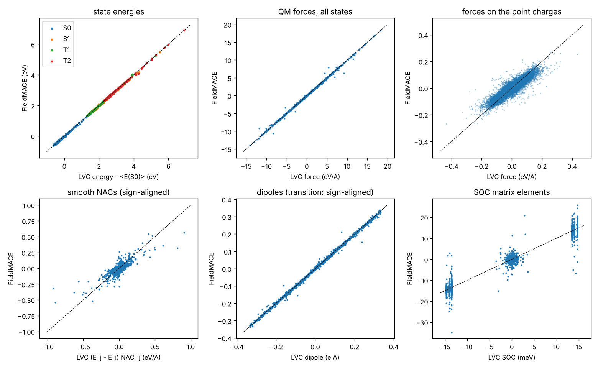
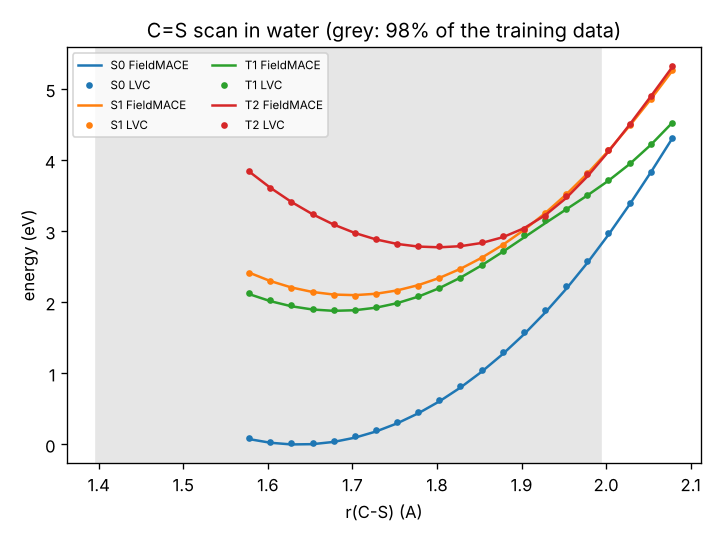

# Tutorial 02: excited states – energies, NACs, dipoles and SOCs

You will train one FieldMACE model that predicts, for a QM region in the field of MM point charges:

* the energies and forces of 4 states (S0, S1, T1, T2), including the forces on the point charges,
* non-adiabatic couplings (NACs) between the states,
* permanent and transition dipoles,
* spin-orbit couplings (SOCs) between all 8 states with triplet M_S components.

Then you will use it from Python (ASE and SHARC calculators). Tutorial 03 runs it in OpenMM, and
tutorial 04 runs surface hopping with it in SHARC.

The system is thioformaldehyde (CH₂S) in a droplet of 100 water molecules, the QM/MM example of
SHARC 4. The reference "QM method" is SHARC's LVC model of CH₂S with a multipolar density fit. It
gives all of the above in the field of the water charges, in milliseconds. The steps are the same with
TDDFT or CASSCF labels from a real QM code.

```
01_sample_configurations.py   -> work/frames.xyz, work/setup.json, work/initconds.npz, work/system_mm.xml
02_label_with_lvc.py          -> data/train.xyz, data/test.xyz                 (needs SHARC 4)
03_train.sh                   -> models/ch2s_es.model
04_evaluate.py                -> error table, results/parity_excited_states.png
05_calculators.py             -> ASE + SHARC calculator demo, results/scan_CS.png
```

Steps 1–2 need SHARC 4 (`$SHARC`) for the example's force field and the LVC model. They take about 3
minutes, so the data are not shipped.

---

## Step 1: sampling

```bash
export SHARC=/path/to/sharc4/bin
python 01_sample_configurations.py
```

This runs classical MD of the droplet and stores 1000 frames: CH₂S plus the 300 water charges, with no
cutoff. Some details matter for excited states:

* **Charges for sampling.** The prmtop has zero charges on CH₂S, because it was made for QM/MM. For sampling,
  CH₂S gets the LVC ground-state charges, so the water orients around it properly.
* **Wider geometries.** Every second frame gets random displacements of the QM atoms (σ = 0.04, 0.08 or
  0.12 Å). Excited-state dynamics leaves the ground-state distribution: here the C=S bond stretches to
  ~1.9 Å, where T2 and S1 cross. The model must have seen such geometries.

  A first version of this tutorial used only σ = 0.04 Å (C=S up to 1.79 Å). The model was then fine near
  equilibrium, but in the QM/MM dynamics of tutorial 04 it sent 75% of the trajectories to S1 where the
  reference stayed in T2: it was extrapolating exactly at the crossing. In production, add frames from
  excited-state trajectories (active learning) or along normal modes.
* **Droplet.** A flat-bottom restraint keeps the droplet together (no periodic box).
* **Other outputs.** The script also saves initial conditions for tutorial 04 and the MM system for
  tutorial 03.

## Step 2: labels and their layout

```bash
python 02_label_with_lvc.py
```

**States.** SHARC's `states 2 0 2` means 2 singlets and 2 triplets, which is 8 states with the triplet
M_S components. The model is trained on the 4 **spatial** states (`--n_energies=4`). The SHARC
interface copies energies, gradients, NACs and dipoles to the M_S components.

**Label layout** (FieldMACE units: eV, Å, e):

| key | shape | content |
|---|---|---|
| `REF_energy` | (1, 4) | energies of S0, S1, T1, T2, including the interaction with the point charges |
| `REF_forces` | (4 atoms, 4 states, 3) | forces on the QM atoms |
| `REF_mm_forces` | (300, 4, 3) | forces on the point charges |
| `REF_nacs` | (4 atoms, 6 pairs, 3) | NACs in 1/Å, pairs ordered (0,1), (0,2), (0,3), (1,2), (1,3), (2,3); pairs of different multiplicity are 0 |
| `REF_smooth_nacs` | (4 atoms, 6 pairs, 3) | smooth NACs (E_j − E_i) · NAC_ij in eV/Å: **the training target** |
| `REF_dipoles` | (4 + 6, 3) | 4 permanent dipoles, then 6 transition dipoles (e Å), same pair order |
| `REF_socs` | (56,) | SOC matrix of all 8 SHARC states (eV): upper triangle h[i, j], i < j, row by row, as (re, im) pairs |

NACs can also be given as (pairs, atoms, 3).

**Smooth NACs.** NACs are proportional to 1/ΔE. In these data they reach ~100 1/Å where T1 and T2 come
within meV, while the median is < 0.001 1/Å. Trained on directly, these few frames dominate the loss and
the model learns NACs badly; that happened in a first version of this tutorial. Smooth NACs,
(E_j − E_i) · NAC_ij, stay below 1 eV/Å, so the model learns those (`--nacs_key=REF_smooth_nacs`). The SHARC
interface turns them back into NACs with the model's own gap (`nac_type smooth` in `FIELDMACE.template`).

**Phases.** The sign of each adiabatic state is arbitrary, so every coupling between two states has an
arbitrary sign too. FieldMACE handles this in the loss:

* **NACs and transition dipoles:** the loss uses the better of the two signs separately for each frame
  and pair, so these labels never need consistent phases.
* **SOCs with `--soc_num`** (one vector per frame): the loss chooses one sign for the whole vector. This is
  only right if the states' signs are consistent between frames. The script makes them consistent by
  aligning every LVC state with the LVC states at the reference geometry. With a real QM code, use
  wave-function overlaps for this (e.g. SHARC's WFoverlap), or train an M_S-resolved model
  (`--n_energies=8`, no `--soc_num`), whose SOC loss chooses the sign per pair.

**Gas-phase frames.** `--gas-fraction 0.1` adds 10% of the frames again without point charges (LVC with
the charges switched off). The model then also knows the zero-field limit. Frames without
`mm_positions`/`mm_charges` are gas-phase frames for FieldMACE; their missing point-charge forces simply
get weight 0. The frames carry `config_type` `solvated` or `gas`, so the error tables show both.

## Step 3: training

```bash
bash 03_train.sh                       # CPU, ~45 min (120 epochs, 16 channels)
DEVICE=cuda EPOCHS=500 CHANNELS=64 bash 03_train.sh
```

The property options:

| option | |
|---|---|
| `--n_energies=4` | 4 states, one energy readout each; forces of every state from one backward pass per state |
| `--compute_nacs=True --nacs_key=REF_smooth_nacs` | smooth NACs: per-atom equivariant vectors (l = 1), one per pair |
| `--compute_dipoles=True --dipoles_key=REF_dipoles` | dipoles: sums of per-atom vectors |
| `--compute_socs=True --socs_key=REF_socs --soc_num=56` | SOCs: per-atom invariant scalars summed, 56 values per frame |
| `--nacs_weight / --dipoles_weight / --socs_weight` | loss weights; the properties have very different sizes, so weigh them |
| `--multipole_max_ell=2` | field gradient at every atom as well: needed for accurate forces on nearby charges |

The weights in the script were tuned once. With the weights first tried (SOCs 1000 instead of 10000,
`multipole_max_ell=1`) the SOC errors were twice as large. If a property is clearly worse than the
others, raise its weight first.

Without `--soc_num`, SOCs are one complex number per state pair of the model
(`REF_socs` of shape (P,) real, (P, 2) or complex). That fits a model with one output per SHARC state
(`--n_energies=8` here).

## Step 4: evaluation

```bash
python 04_evaluate.py
```

This prints MAEs for energies, excitation energies, QM forces, point-charge forces, NACs, permanent and
transition dipoles, and SOCs. Couplings are compared with the sign chosen as in training. The parity
plots are in `results/`. With the defaults (165 test frames; 16 channels, 120 epochs on a CPU):

| property | MAE | mean size of the labels |
|---|---|---|
| state energies | 19 meV | spread (std) 0.6–0.7 eV |
| excitation energies | 27 meV | 1.9–3.1 eV |
| QM forces | 35 meV/Å | 1.6 eV/Å |
| point-charge forces | 2.2 meV/Å | 8 meV/Å (max 0.4 eV/Å) |
| smooth NACs (S0–S1, T1–T2) | 0.021 eV/Å | 0.027 eV/Å (max 0.9 eV/Å) |
| transition dipoles | 0.0009 e Å | up to 0.3 e Å |
| SOCs (non-zero elements) | 1.4 meV | 14 meV |



* **Not converged.** The validation error was still falling at epoch 120. On a GPU, train longer and
  wider (`EPOCHS=400 CHANNELS=64`).
* **NACs.** NACs are the weakest property. Most couplings are tiny, and the error is as large as the
  average coupling. The large couplings, which drive the hops, come out too small (slope < 1 in the plot).
  That slows down internal conversion in the dynamics of tutorial 04. More data near the crossings, a
  larger model and a higher `--nacs_weight` help.
* **Solvent.** Each water configuration shifts the excitation energies by ±40–80 meV (standard deviation
  over geometries). The model follows these shifts with correlation 0.78 (S1), 0.86 (T1) and 0.91 (T2).

## Step 5: using the model from Python

```bash
python 05_calculators.py
```

* **ASE.** `MACECalculator(model, device, state=k)`. The point charges go into
  `atoms.info["mm_positions"]` (Å) and `atoms.info["mm_charges"]` (e). The results hold `energies` (all
  states), `forces` (state k), `forces_all`, `mm_forces`, `nacs`, `dipoles` and `socs`.
* **Solvent shift.** The same geometries are evaluated with and without the water, and the mean shift of
  the excitation energies is compared with LVC.
* **SHARC.** `SharcCalculator(elements, model, states=[2, 0, 2], nac_type="smooth", properties=[...])` returns SHARC's QM.out
  quantities in atomic units: `h` (8×8, energies + SOCs), `grad`, `grad_pc`, `nacdr`, `dm`. This is exactly
  what the SHARC interface passes to SHARC.
* **Scan.** A C=S bond scan in the field of one water configuration compares FieldMACE with LVC
  (5–25 meV inside the range of the training data, grey). Outside that range the model extrapolates; add
  data where your dynamics go.



The single-frame demos use the first test frame without a close hydrogen bond; `--frame k` picks
another one.

---

## Next

* [Tutorial 03](../03_openmm_mlmm_md/), part 2: excited-state ML/MM MD in OpenMM.
* [Tutorial 04](../04_sharc_dynamics/): surface hopping with SHARC 4.
