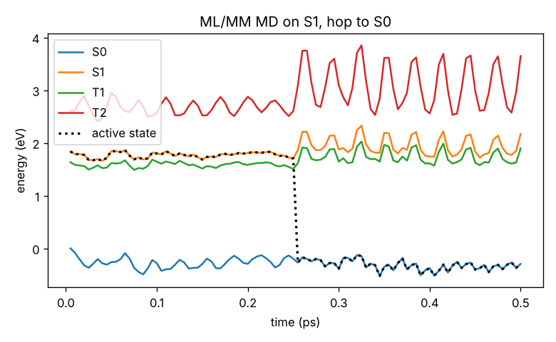
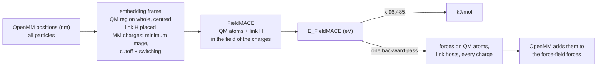
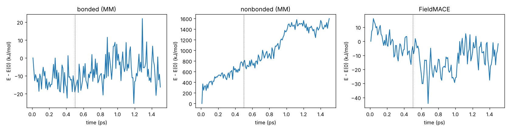

# Tutorial 03: ML/MM molecular dynamics in OpenMM

*Author: Rhyan Barrett*

FieldMACE runs inside OpenMM as an `openmm.PythonForce` (OpenMM ≥ 8.3), or as an `openmmtorch.TorchForce`. The model describes the QM region in
the field of the MM point charges, and everything else is the force field. Any force field OpenMM reads
works.

```
01_mlmm_md.py          ground state: alanine side chain in water (model from tutorial 01), NVT + NVE
02_multistate_md.py    excited states: CH2S in water (model from tutorial 02), switching states, all-state energies
03_active_learning.py  find configurations the model is unsure about, for the next round of training
04_active_learning_loop.sh  the automated loop: train committee, ML/MM MD, select, label (PySCF), repeat
05_how_it_works.py     what the interface does to the force field, link atoms, embedding, energy bookkeeping, exact forces
06_other_inputs.py     the same set-up from Amber, GROMACS, OpenMM XML and serialized inputs; choosing the QM region
07_md_recipes.py       platform, time step, NVT/NPT, reporters, energy components, restarts, cost
```

New to the interface? Read part 5 first, then part 1.

---

## Part 1: ground-state ML/MM MD

```bash
python 01_mlmm_md.py                          # model from tutorial 01, 2 ps NVT + 1 ps NVE (from work/equilibrated.pdb)
python 01_mlmm_md.py --device cuda --nvt-ps 100
```

The core is one call:

```python
from mace.mlmm import create_fieldmace_mm_system
from mace.mlmm.dataset import load_setup

qm_atoms, settings, prep_kw = load_setup("../01_data_and_training/data/setup.json")
system, spec, comp = create_fieldmace_mm_system(mm_system, qm_atoms, "model.model", topology=topology,
                                                settings=settings, **prep_kw)
```

What it does to the force-field system (a copy; the original is untouched):

| term | QM–QM | QM–MM | MM–MM |
|---|---|---|---|
| Coulomb | FieldMACE | FieldMACE (point charges) | force field |
| Lennard-Jones | removed (FieldMACE) | force field | force field |
| bonds, angles, torsions | removed if all atoms are QM | force field | force field |

* **Link atoms.** Link atoms are placed on the QM–MM bonds every step. Their forces go to the QM and MM
  atoms by the chain rule, and the MM charges hidden by the link scheme are left out.
* **Cutoff.** The cutoff with its switching function and periodic imaging around the QM region are part of
  the computational graph, so the forces are exact derivatives of the energy. The NVE run checks this.
* **Speed.** Forces on QM atoms, link atoms and all point charges come from **one backward pass** on the
  GPU. For QM regions up to 128 atoms the model graph is built once ("static graph"), so no neighbour list
  is rebuilt each step.
* **Same embedding as training.** `setup.json` stores QM atoms, link atoms and their charge scheme,
  cutoff, switching width and origin, as used for the training data. Use it, or the model is evaluated in
  a frame it was not trained in.

**What to look at.**

* **Speed.** The script prints ms/step: ~28 ms on 2 CPU cores, where the model dominates. For
  comparison, the ML/MM benchmark of `scripts/check_env.py --gpu` ran at ~22 ms/step on an H100 MIG slice
  (ZIH Capella).
* **NVE energy conservation.** Expect a total-energy fluctuation much smaller than the kinetic-energy
  fluctuation, and no systematic drift. Here: std 1.2 kJ/mol against 91 kJ/mol for the kinetic energy,
  with a drift of −0.05 kJ/mol/ps for a float32 model at 0.5 fs. If it drifts more, use a smaller time
  step, a `--default_dtype=float64` model, or check that the cutoff in `setup.json` matches training.

**Starting MD from random velocities.** If the system has a `CMMotionRemover` (most force fields add one),
the first step removes the centre-of-mass motion of the random velocities, about 3/2 kT. Measure energy
conservation from the first step on, not from the velocities you set.

**Units inside OpenMM.** The model works in eV and Å. The force converts to kJ/mol and nm (and back for
positions); `energy_scale` and `length_scale` in `model_kwargs` cover models trained in other units.

**Serialization.** The force pickles the model *path* (not the weights), so `XmlSerializer` and
checkpoints work when the model is given as a file.

**TorchForce backend.** `python 01_mlmm_md.py --backend torch` runs the model as an `openmmtorch.TorchForce`
instead: TorchScript in libtorch, with no Python call per step. The device follows the OpenMM platform (CUDA
platform, GPU). Install it from conda-forge, together with PyTorch from conda-forge:

```bash
conda install -c conda-forge openmm-torch "pytorch=*=cuda*"   # or =cpu* without a GPU
```

```python
system, spec, force = create_fieldmace_mm_system(mm_system, qm_atoms, "model.model", topology=top,
                                                 settings=settings, backend="torch")
```

Energies and forces are identical to the PythonForce, and `fieldmace_state` works the same way. Only
`computation.last`, the per-step energies of all states, is not available, so for multi-state reporting use
the default backend. On a CPU both backends take the same time (the model dominates). The TorchForce helps
on GPUs and for running without Python.
`mace.mlmm.export_torchscript(model, spec, "fieldmace_qmmm.pt")` writes the complete ML/MM potential as one
TorchScript file for other programs.

**OpenMM versions.** OpenMM 8.6 passes the force only its own particles. 8.3–8.5 pass all of them, and the
force then picks its own. Both work.

## Part 2: excited states, switching states

```bash
python 02_multistate_md.py                    # model from tutorial 02
```

* **State.** The state that drives the dynamics is the context parameter `fieldmace_state`:
  `context.setParameter("fieldmace_state", 1)`.
* **All-state energies.** `FieldMACEStateReporter(file, interval, comp)` writes the energies of all states
  at every report (CSV: step, time, active state, E0, E1, ...).
* **Couplings.** `comp.last` holds the latest `energies` and, if the model predicts them, `nacs`,
  `dipoles` and `socs`. `nacs` is whatever the model was trained on: for the tutorial-02 model, smooth NACs
  (E_j − E_i) · NAC_ij.

The script runs NVE on S1, then switches to S0 by hand and rescales the velocities so the total energy is
conserved. The total energy changes by 0.2 meV in 0.25 ps on either state. After the hop, the released
~1.9 eV heats the system and the C=S stretch, which shows up as the large oscillations of the excited
states.



Rescaling the velocities at a hop is what a surface-hopping code does too, with the hops decided from
NACs and SOCs. For real nonadiabatic dynamics use SHARC ([tutorial 04](../04_sharc_dynamics/)), which runs FieldMACE
with OpenMM as the MM engine through `SHARC_QMMM`.

## Part 3: active learning

```bash
python 03_active_learning.py
```

The first model was trained on classical-MD geometries, but ML/MM MD visits the model's own distribution.
The script runs ML/MM MD a bit hotter than the data (400 K) and stores frames in exactly the training
format (`frame_to_atoms` with the force's `EmbeddingFrame`). It evaluates a committee of models on them
and writes the frames with the largest disagreement to `work/al_candidates.xyz`. Label these with
`01_data_and_training/03_label_with_pyscf.py --frames work/al_candidates.xyz`, add them to the training
set and retrain. Repeat until the committee agrees along your production trajectories. A committee of
the same architecture with different seeds (`SEED=2 bash 04_train.sh`) is the usual choice.
`MACECalculator` with several model paths returns `energy_var` and `forces_var` directly.

## Part 4: the automated loop

```bash
bash 04_active_learning_loop.sh               # = fieldmace_active_learning --config al.yaml
bash 04_active_learning_loop.sh --status
```

`fieldmace_active_learning` repeats part 3 until the committee agrees. Each round:

1. **train** a committee (`committee_size` models, seeds 1, 2, …) on the current training set with the
   `mace_run_train` flags in `train_args`;
2. **sample**: ML/MM MD with the first model at each temperature in `sampling` (PythonForce, or
   TorchForce with `backend: torch`). Frames are stored in the training format. A trajectory that blows
   up stops; its frames up to then are kept;
3. **select**: committee force disagreement per frame (max over atoms and states). Frames between
   `force_std_min` and `force_std_max` are candidates; the most uncertain ones are taken, at least
   `min_separation` frames apart. Above `force_std_max` the model is so far off that the geometry is
   probably unphysical, so it is not labelled;
4. **label** with `labeller`: `pyscf` (as in tutorial 01), `model:<path>` (a bigger model as the
   reference), `file.py:function` or `module:function` (your QM code: frames in, labelled frames out,
   see `mace/mlmm/labelers.py`), or `external`. With `external` the loop writes
   `round_NN/candidates.xyz` and stops. Label them on your cluster, write `round_NN/labelled.xyz` and run
   the same command again;
5. **merge** into `round_NN/train.xyz`, the training set of the next round.

It stops after `rounds` rounds, or when fewer than `converged_fraction` of the MD frames are uncertain.
`state.json` in the work directory records the progress, so the loop resumes where it stopped (after a
time limit, a crash or external labelling). `fieldmace_active_learning --example` prints an annotated
configuration. For excited-state and diabatic models, the disagreement covers the forces of all states
and `sampling.state` chooses the driving state.

On a cluster, run each round as one job (`--rounds 1`), or split the labelling into its own job array with
`labeller: external`.

## Part 5: how the interface works

```bash
python 05_how_it_works.py                     # prints everything below for tutorial 01's system
```

`create_fieldmace_mm_system` does two things: it turns the force-field System into the MM part of a
QM/MM System (`prepare_qmmm_system`), and it adds one force that evaluates FieldMACE every step.



**1. Energy partition.** With electrostatic embedding, the QM energy from a calculation with external
point charges already contains the QM–MM electrostatics. So:

```
E_total = E_forcefield(MM–MM all terms; QM–MM Lennard-Jones; bonded terms that touch an MM atom)
        + E_FieldMACE(QM region in the field of the MM charges)
```

To avoid double counting, `prepare_qmmm_system` changes a copy of the System:

| what | why |
|---|---|
| QM charges set to 0 in the `NonbondedForce` | QM–QM and QM–MM Coulomb are in FieldMACE |
| all QM–QM pairs excluded (charge and LJ) | QM–QM interactions are in FieldMACE |
| bonds, angles, torsions with **only** QM atoms removed | the same |
| terms that mix QM and MM atoms kept | e.g. the CA–N bond across the boundary, its angles and torsions |
| QM–MM Lennard-Jones kept | FieldMACE has no Pauli repulsion or dispersion with the MM atoms |
| constraints between QM atoms removed | the model describes those bonds |

The script prints the term counts before and after for every force (here 5 bonds, 7 angles and 3 torsions
are removed). Unsupported forces, such as implicit solvent or polarisable multipoles, raise an error
instead of being silently wrong. Pass `keep_forces=[...]` for your own restraints between QM atoms.

**2. Link atoms.** Every covalent QM–MM bond is cut and capped with a hydrogen at
r_QM + g (r_MM − r_QM). The factor g gives a typical X–H distance (C–H 1.09 Å) at the equilibrium bond
length. The link H is recomputed every step, and its force is passed to the QM atom and the MM host by
the chain rule. Charges right next to the cut would polarise the link unphysically, so the charge
scheme hides some of them from the model. They stay in the force field:

| scheme | hidden from FieldMACE | here |
|---|---|---|
| `Z0` | nothing | 2263 charges |
| `Z1` (default) | the MM host atom | N and C of the backbone |
| `Z2` | + the host's bonded neighbours | + H, O, ACE C, NME N |
| `Z3` | + one shell further | + methyl groups of the caps |

The scheme is part of the training data. It is stored in `setup.json`; use the same one in MD.

**3. Embedding frame.** `EmbeddingFrame` is the single place where coordinates become model inputs. It
is used both when writing training data (`frame_to_atoms`) and in every MD step. Here 208 of 2261
charges are within the 8 Å cutoff, and 115 of them are scaled by the C² switching function between 6 and
8 Å. The switch makes the energy smooth when a water crosses the cutoff, and its derivative is part of
the force.

**4. Bookkeeping and force groups.** The FieldMACE force can get its own force group
(`create_fieldmace_mm_system(..., force_group=31)`), so its energy is
`context.getState(getEnergy=True, groups={31})`. It is large (−2172 eV here) because it contains the
atomic reference energies. Only differences matter, but `model_kwargs=dict(subtract_e0=True)` removes
them if you want readable numbers. The forces do not change.

**5. Exact forces.** Finite differences of the FieldMACE energy against its forces, for a QM atom, the
link host N (force only through the link H) and a water hydrogen in the switching zone (force only
through its scaled charge). They agree to 0.02 kJ/mol/nm:

```
QM atom                          ALA2:CA: force [ 295.678  559.694 -551.154]  finite diff. [ 295.687  559.7   -551.139]
MM link host                      ALA2:N: force [-250.759    2.154   96.774]  finite diff. [-250.759    2.146   96.773]
MM charge in the switching zone HOH10:H2: force [ -7.673   7.359 -10.387]  finite diff. [ -7.673   7.359 -10.387]
```

## Part 6: other force fields and inputs

```bash
python 06_other_inputs.py                     # needs openmmtools (example Amber files) and ParmEd (GROMACS)
```

FieldMACE only sees an `openmm.System`. `mace.mlmm.io.load_system` builds one from any common input,
and the rest is the same:

```python
from mace.mlmm.io import load_system, select_atoms, constrain_hbonds_except

s = load_system(pdb="sys.pdb", forcefield=["amber14-all.xml", "amber14/tip3p.xml"])     # OpenMM ffxml
s = load_system(prmtop="sys.prmtop", inpcrd="sys.inpcrd")                              # Amber (tleap)
s = load_system(top="topol.top", gro="conf.gro", gmx_include="/usr/share/gromacs/top")  # GROMACS, OPLS-AA
s = load_system(psf="sys.psf", pdb="sys.pdb", charmm_params=["par.prm", "top.rtf"])     # CHARMM
s = load_system(system_xml="system.xml", pdb="sys.pdb")                                 # any serialized System
qm = select_atoms(s.topology, "resid 2 and name CA HA CB HB1 HB2 HB3")
```

`load_system` takes `constraints=None` (then call `constrain_hbonds_except`), `cutoff_nm` and
`nonbonded_method`. Systems without a box get `NoCutoff` automatically.

```
route                                     atoms  QM links charges  E_FieldMACE (eV)  ms/step
A  PDB + ffxml (Amber14/TIP3P)             2269   6     2     177           -0.2050     29.2
B  Amber prmtop/inpcrd (ff96)              2269   6     2     177           -0.2037     26.5
C  GROMACS top/gro (ff96, via ParmEd)      2269   6     2     177           -0.2044     27.9
D  serialized system.xml + PDB             2269   6     2     177           -0.2050     24.9
```

All four start from the same coordinates. A and D are the same System and give the same energy. B and C
are the same ff96 System; C differs a little because `.gro` stores coordinates to 0.001 nm. A against B
is the effect of the force field's charges alone: the model sees different point charges.

**Train with the force field you run with.** The MM charges are an input of the model, so a model
trained with Amber14 charges is extrapolating with CHARMM or OPLS charges. The plumbing works for any
force field, but the training data should come from the same one (tutorial 01 step 1 takes the same
options).

**Choosing the QM region.** `select_atoms` understands `resname`, `resid`, `name`, `element` and
`index`, combined with `and` (binds first) and `or`:

| selection | atoms |
|---|---|
| `resname LIG` | a ligand |
| `resid 2 and name CA HA CB HB1 HB2 HB3` | a side chain from CA (two link atoms) |
| `resname LIG or resid 88 and name OG HG` | a ligand plus a hydroxyl |
| `index 8-13` | explicit indices |

Cut through C–C single bonds, never through polar or conjugated bonds. Keep charged groups whole, and
keep the QM region the same between training and MD.

**Ligands and small molecules.** Use openmmforcefields: register `GAFFTemplateGenerator` or
`SMIRNOFFTemplateGenerator` on a `ForceField`, then build the System as in route A. Without
openmmforcefields, [tutorial 06](../06_ligand_in_pocket/) turns an antechamber/tleap `ligand.prmtop`
into a ForceField XML.

## Part 7: MD recipes

```bash
python 07_md_recipes.py                       # 0.5 ps NVT + 1 ps NPT, restart, cost per step
```

**Platform.** OpenMM picks the fastest platform. The script asks for it explicitly (CUDA > HIP > OpenCL >
CPU, mixed precision on GPUs). The model device is separate (`model_kwargs=dict(device="cuda")`, default:
CUDA if available). On a GPU node, use the CUDA platform *and* the CUDA device. With the TorchForce
backend, the model always runs where the OpenMM platform runs.

**Start structure.** Start from an equilibrated structure at the right density. The raw
`inputs/aladip_solvated.pdb` has too large a box (water at 0.66 g/mL). Tutorial 01 step 1 equilibrates
it at 1 bar (0.98 g/mL) before sampling the training data, and the tutorial-03 scripts start from that
`work/equilibrated.pdb`. With the raw box, the barostat shrinks the volume by 11% within 1 ps, and until
then the model sees a sparser solvent than in training. From the equilibrated box the volume changes by
2% (22.88 → 22.42 nm³ in 1 ps).

**Time step.**

* Build the System with `constraints=None`, then `constrain_hbonds_except(system, topology, qm_atoms)`.
  The MM X–H bonds are constrained, and the QM X–H bonds stay flexible, because the model describes them.
* With flexible QM C–H bonds, 0.5 fs is safe and 1 fs usually works; check with a short NVE run (part 1).
* Hydrogen mass repartitioning of the MM part does not help much while QM hydrogens limit the step.

**Ensembles.**

* `LangevinMiddleIntegrator` for NVT.
* For NPT, add a `MonteCarloBarostat` and call `context.reinitialize(preserveState=True)`. The barostat
  scales molecule centres, and FieldMACE is evaluated at the new positions, so NPT needs nothing special.
* `VerletIntegrator` for NVE checks.

**Reporters.**

| reporter | what |
|---|---|
| `StateDataReporter` | energy, temperature, volume, density, speed |
| `DCDReporter` | trajectory (view it with the PDB topology) |
| `FieldMACEStateReporter(file, n, comp)` | FieldMACE energies of all states, the active state |
| force groups + a small reporter | energy components: bonded, MM nonbonded, FieldMACE (see `ComponentReporter` in the script) |



**Restarts.**

* `simulation.saveState("state.xml")` and `loadState` are portable across machines and platforms. The
  file holds positions, velocities, box, time and the `fieldmace_state` parameter.
* `saveCheckpoint` also keeps the integrator's random state, but only works on the same platform.
* `XmlSerializer.serialize(system)` stores the ML/MM System itself. It works with the PythonForce
  backend when the model was given as a file path.

**Cost.** On a CPU the model dominates. The number of point charges matters less than you might expect:

```
PythonForce, cutoff   6.0 A:    88 point charges,   27.8 ms/step
PythonForce, cutoff   8.0 A:   213 point charges,   30.4 ms/step  <- setup.json (what the model was trained with)
PythonForce, cutoff  None A:  2261 point charges,   33.6 ms/step
```

Only the cutoff the model was trained with gives the right physics. The others only show the cost. For
long runs: use a GPU, a float32 model, and the static graph (automatic for QM regions up to 128 atoms).
Use the TorchForce backend when Python per step becomes the bottleneck, which happens with small
models on fast GPUs.

**Checklist for a production run.**

1. Same QM selection, link scheme and embedding (`setup.json`) as the training data.
2. Same force field (charges) as the training data.
3. NVE check of energy conservation at your time step.
4. A committee or active learning (parts 3–4) to check that the trajectory stays where the model was trained.
