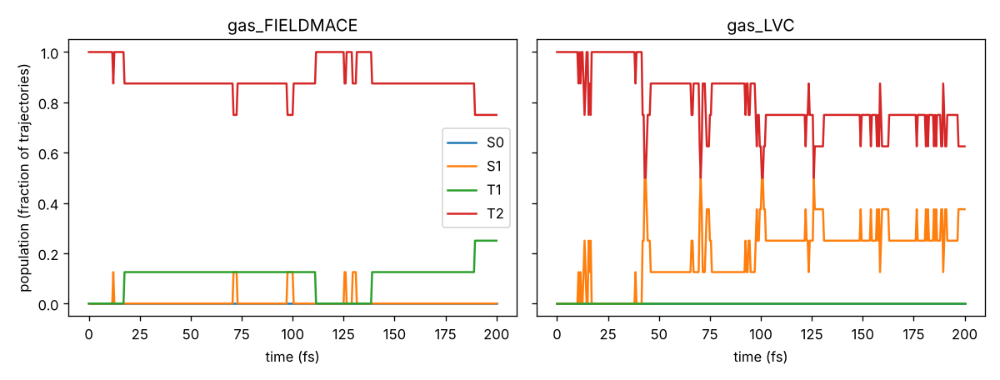
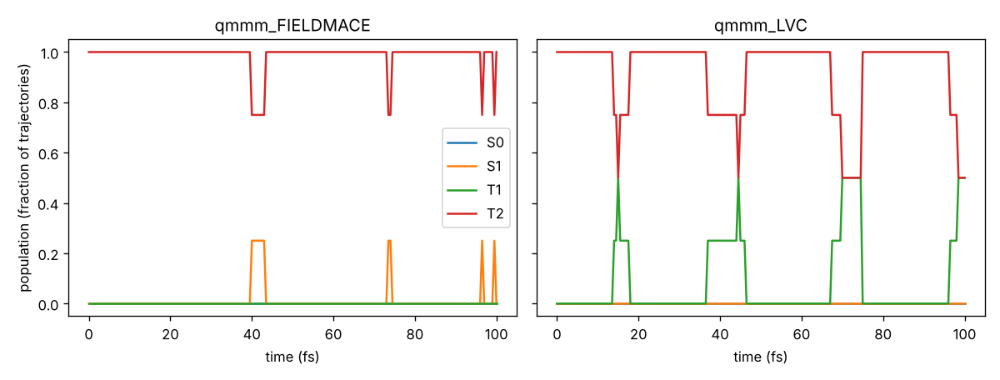

# Tutorial 04: surface hopping with SHARC 4

*Author: Rhyan Barrett*

FieldMACE models drive SHARC 4 through the interface `sharc/SHARC_FIELDMACE.py`, in every mode SHARC
offers:

| mode | how SHARC calls the interface |
|---|---|
| `sharc.x` | runs `QM/runQM.sh` → `$SHARC/SHARC_FIELDMACE.py QM.in` every time step |
| pysharc | `$SHARC/driver.py -i FIELDMACE input`: SHARC runs in-process and the model stays loaded; same trajectory, ~50× faster |
| QM/MM | `SHARC_QMMM` with `qm-program FIELDMACE` and `mm-program openmm`; FieldMACE gets the MM charges as point charges and returns gradients on them |

This tutorial uses the CH₂S model from [tutorial 02](../02_excited_states/). It runs the same trajectories
with the LVC reference, so you can check the model where it matters: in the dynamics.

```
00_install.sh              link the interface into $SHARC, check SHARC, pysharc, examples
01_single_point.py         one QM.in through SHARC_FIELDMACE.py and SHARC_LVC.py, compared
02_setup_trajectories.py   TRAJ_* directories: --mode gas|qmmm  --interface FIELDMACE|LVC
03_run_trajectories.sh     run them with pysharc (default) or sharc.x (ENGINE=sharcx)
04_analyze.py              populations, hops, energy conservation; FieldMACE vs LVC
sharc_tools.py             file formats (geom, veloc, input, output.lis)
```

---

## Step 0: installation

No SHARC yet? `sharc/install_sharc4.sh` in the FieldMACE repository builds SHARC 4 with `sharc.x` and
pysharc in a conda environment or in your virtual environment, and tests it:

```bash
bash ../../sharc/install_sharc4.sh --env venv --venv /path/to/your/venv --prefix ~/software   # or --env conda
source ~/software/sharc4/sharc_env.sh
```

With SHARC installed (by the script or otherwise):

```bash
export SHARC=/path/to/sharc4/bin         # SHARC 4.0 or 4.1 (sharc_env.sh sets this)
bash 00_install.sh
```

The interface is part of the FieldMACE repository. SHARC finds interfaces in `$SHARC`, so the script
links it there: `ln -s $FIELDMACE/sharc/SHARC_FIELDMACE.py $SHARC/`. FieldMACE must be importable by
the Python that runs SHARC. pysharc needs SHARC built with `USE_PYSHARC=true`; without it, use
`ENGINE=sharcx`.

## Step 1: a single point

```bash
python 01_single_point.py
```

This writes a `QM.in` (CH₂S in bohr, 300 water charges in `pc.txt`, requests `h soc dm grad nacdr`)
and runs both `SHARC_FIELDMACE.py` and `SHARC_LVC.py` on it. It then compares the `QM.out` files, read
with SHARC's own parser: energies of all 8 states, SOCs, gradients on the atoms and on the point charges,
NACs and dipoles.

The `FIELDMACE.template`:

```
model_file     /path/to/ch2s_es.model     # or "modelpath" in FIELDMACE.resources
properties     energy forces nacs dipoles socs
device         cpu                        # or cuda
energy_unit    eV                         # units the model was trained in
distance_unit  Angstrom
nac_type       smooth                     # the model predicts (E_j - E_i) * NAC_ij (tutorial 02)
# soc_selection_rules true                 default, see below
# nac_to_au / dipole_to_au / soc_to_au     optional unit conversions (defaults follow eV and Angstrom)
```

**How the states map.**

* **Spatial model** (`n_energies` = 4 for `states 2 0 2`): the triplet energies, gradients, NACs and
  dipoles are copied to the 3 M_S components. NACs and transition dipoles connect states of the same
  multiplicity and M_S. SOCs come from the `--soc_num` vector.
* **M_S-resolved model** (`n_energies` = 8): each model state is one SHARC state.
* **Other combinations** fail with a message that says what to train.

**Phases.** FieldMACE aligns the signs of NACs, transition dipoles and SOCs with the previous time step
and reports all phases as +1. The reference is kept in memory (pysharc) and in
`SAVE/FIELDMACE_previous.npz` (`sharc.x`), so restarts continue smoothly.

Comparing couplings from two different calculations needs care: each state's wave-function sign is
arbitrary, so the script compares the SOC matrices after choosing the best sign for every state, and the
NACs pair by pair.

**SOC selection rules (`soc_selection_rules`, default on).** Some SOC matrix elements vanish exactly:

* between two singlets;
* between the M_S components of the same multiplet (real, non-degenerate spatial states);
* for |ΔM_S| > 1 (the spin-orbit operator has spin rank 1).

The model predicts them as small numbers (~1 meV of noise), and the interface sets them to zero. This
matters for dynamics: the M_S components of a triplet are exactly degenerate, so even tiny couplings
between them rotate the diagonal states every step. That causes many spurious hops and worse energy
conservation; in a test with an earlier model, the energy error of the T2 trajectories was three times larger without the
rules.

## Step 2: trajectories

```bash
python 02_setup_trajectories.py --mode gas  --interface FIELDMACE                       # 8 x 200 fs from T2
python 02_setup_trajectories.py --mode gas  --interface LVC
python 02_setup_trajectories.py --mode qmmm --interface FIELDMACE --ntraj 4 --tmax 100
python 02_setup_trajectories.py --mode qmmm --interface LVC       --ntraj 4 --tmax 100
```

* **Initial conditions.** These are classical-MD snapshots from tutorial 02. All trajectories start in T2
  (`--state 4`, SHARC's MCH numbering: 1 S0, 2 S1, 3/5/7 T1 with M_S = −1/0/+1, 4/6/8 T2). T2 decays to T1
  and mixes with S1 within 200 fs, which gives the populations something to show. Started in S1, CH₂S stays
  there: intersystem crossing takes picoseconds. For production, use SHARC's tools (`wigner.py` or
  `amber2init.py` → `setup_init.py` → `excite.py` → `setup_traj.py`); `setup_traj.py` lists FIELDMACE as
  an interface.
* **SHARC input.** `nstates 2 0 2`, `coupling ddr` (NACs from the model), `surf sharc` (hopping in the
  diagonal basis, with SOCs), `decoherence_scheme edc`, `ekincorrect parallel_vel`. Time step 0.5 fs.
* **QM/MM.** The files come from SHARC's example `SHARC_QMMM_LVC_OPENMM`: `QMMM.table` (QM/MM atom types
  and connectivity), `MML/` and `MMS/` (OpenMM inputs for the large and the small MM system). Only the
  template changes:

  ```
  qm-program FIELDMACE
  mm-program openmm
  embedding  subtractive
  qm-dir     ./FM          # contains FIELDMACE.template
  ```

  SHARC_QMMM passes the MM charges to FieldMACE as point charges. FieldMACE's gradients on these charges
  (`grad_pc`) are added to the MM atoms.
* **`nophases_from_interface`.** QM/MM inputs get this keyword because SHARC_QMMM (SHARC 4.0/4.1) does
  not pass the QM program's phases on, and `sharc.x` would stop otherwise. FieldMACE keeps the signs
  consistent itself, so nothing is lost.

## Step 3: running

```bash
bash 03_run_trajectories.sh runs/gas_FIELDMACE            # pysharc
bash 03_run_trajectories.sh runs/gas_LVC
ENGINE=sharcx bash 03_run_trajectories.sh runs/qmmm_FIELDMACE
```

On a cluster, run trajectories in parallel, e.g. a SLURM array over the `TRAJ_*` directories, each running
`python $SHARC/driver.py -i FIELDMACE input` (QM/MM: `-i QMMM`). With `device cuda` in the template, many
trajectories can share a GPU.

## Step 4: analysis

```bash
python 04_analyze.py runs/gas_FIELDMACE runs/gas_LVC
python 04_analyze.py runs/qmmm_FIELDMACE runs/qmmm_LVC
```

This prints, for every trajectory, how often the spatial state changed and how well the total energy
was conserved. It plots the S0/S1/T1/T2 populations (triplet M_S components summed) of FieldMACE next to
LVC in `results/populations.png`.

What we got with the default model of tutorial 02 (16 channels, 120 epochs on a CPU):

| | FieldMACE | LVC (reference) |
|---|---|---|
| gas phase, 8 × 200 fs: populations at 200 fs, S1 / T1 / T2 | 0.00 / 0.25 / 0.75 | 0.38 / 0.00 / 0.62 |
| gas phase: changes of the spatial state per trajectory | 0–7 | 0–24 |
| gas phase: max. total-energy error per trajectory | 1–12 meV | 1–43 meV |
| QM/MM, 4 × 100 fs: populations at 100 fs, T1 / T2 | 0.00 / 1.00 | 0.50 / 0.50 |
| QM/MM: max. total-energy error per trajectory | 33–50 meV | 34–62 meV |




**How to read this.**

* **The machinery works.** FieldMACE drives SHARC through all interfaces, conserves energy as well as the
  reference, and its states mix and hop.
* **Populations differ.** FieldMACE moves less population out of T2 than LVC does. With 8 (or 4)
  trajectories the uncertainty is about ±0.2, but the trend is consistent. It matches what tutorial 02
  found: the model underestimates the large NACs and SOCs that drive the transitions.
* **This is the point of the comparison.** Errors of a few tens of meV in energies look fine in a parity
  plot, but couplings that are too weak change the dynamics. Before production, check against the
  reference on a few trajectories, then improve the model where it matters:
  * train longer and wider on a GPU (`EPOCHS=400 CHANNELS=64`);
  * add frames near the crossings the trajectories visit (active learning: ML trajectories → frames →
    reference labels → retrain);
  * raise `--nacs_weight` and `--socs_weight`.
* **More trajectories.** For converged populations run 100+ trajectories.

SHARC's `data_extractor.x` and `populations.py` work on these directories as usual.

**Energy conservation.**

* **Gas phase:** the total energy is conserved to ~1–40 meV over 200 fs, for FieldMACE and LVC alike.
  The largest errors come from hops with `nogradcorrect`.
* **QM/MM:** the total energy oscillates by 30–60 meV at 0.5 fs, the same with FieldMACE and LVC. It comes
  from the flexible water of the MM part (O–H vibrations), not from the model.

---

## Troubleshooting

| message | meaning |
|---|---|
| `SHARC states [..] do not match the model's N states` | train with `n_energies` = number of spatial states, or of SHARC states with M_S |
| `SOCs requested, but FIELDMACE.template does not list 'socs'` | add `socs` to `properties` (the model must have been trained with `--compute_socs`) |
| `'QMout' object has no attribute 'phases'` (QM/MM, sharc.x) | add `nophases_from_interface` to the SHARC input |
| `No 'grad_pc' in QMout` | the QM program did not get point charges; check `QMMM.template` |
| pysharc: `sharc.sharc import failed` | SHARC was built without pysharc; use `ENGINE=sharcx` or rebuild with `USE_PYSHARC=true` |
