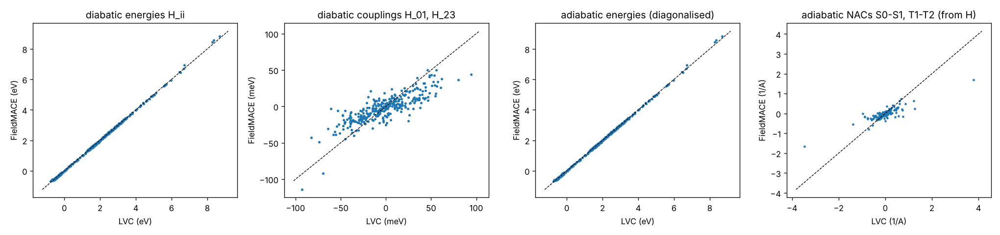
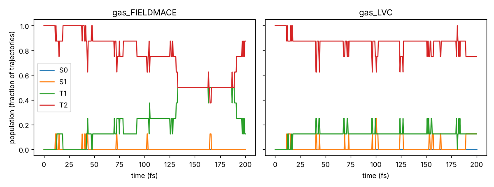
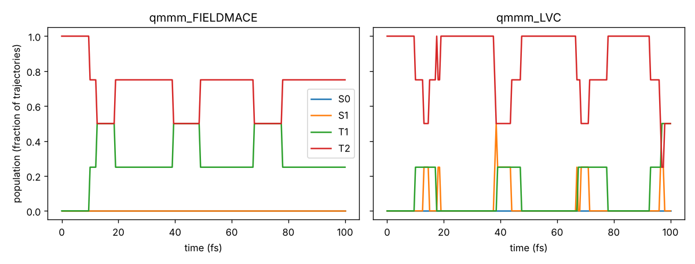

# Tutorial 05: diabatic states – learning the diabatic Hamiltonian, dynamics in SHARC

*Author: Rhyan Barrett*

Tutorials 02 and 04 learn **adiabatic** quantities: energies, gradients and NACs of the eigenstates.
Adiabatic NACs are hard to learn. Their sign is arbitrary, they diverge where two states cross, and the
model has to learn the phase convention. A **diabatic** model avoids all of that. It learns the
diabatic Hamiltonian H(R, MM charges), a small symmetric matrix whose elements are smooth functions of
the geometry, and everything adiabatic follows from diagonalising it:

```
H = U diag(E) Uᵀ
adiabatic energies   E_k
gradients            dE_k/dR = (Uᵀ dH/dR U)_kk                 (Hellmann–Feynman, exact)
NACs                 d_kl    = (Uᵀ dH/dR U)_kl / (E_l − E_k)
```

NACs come out right at a crossing (the 1/ΔE is exact, not learned), and they come out on the MM atoms
too, because the model also predicts dH/d(point-charge positions). An adiabatic model can't give
NACs on MM atoms.

You will:

1. make diabatic labels for CH₂S in water: all 10 elements of the 4×4 diabatic Hamiltonian, their
   gradients on the QM atoms and on all 300 water charges, diabatic dipoles and SOCs,
2. train a diabatic FieldMACE model (`--diabatic=True`),
3. check the diabatic elements and the adiabatic energies and NACs that follow from them,
4. run surface hopping in SHARC 4 with it, gas phase and QM/MM, with NACs or with wave-function
   overlaps, and compare with the reference.

```
01_sample_configurations.sh   -> work/frames.xyz, work/initconds.npz, ...      (as tutorial 02, needs SHARC)
02_label_diabatic.py          -> data/train.xyz, data/test.xyz                 (needs SHARC)
03_train.sh                   -> models/ch2s_diabatic.model
04_evaluate.py                -> error table, results/parity_diabatic.png
05_sharc_dynamics.sh          -> runs/<coupling>/{gas,qmmm}_{FIELDMACE,LVC}/, results/<coupling>_<mode>/populations.png
```

---

## Does SHARC support diabatic models?

SHARC propagates the electronic wave function in the **MCH basis**: the eigenstates of the
spin-free Hamiltonian, with SOCs on top. It has no input for a diabatic Hamiltonian. That is not a
limitation: SHARC's own LVC interface is a diabatic model too. It builds a diabatic H, diagonalises it
and gives sharc.x adiabatic quantities. The FIELDMACE interface does the same with a diabatic
FieldMACE model, every time step:

| SHARC request | what the interface returns |
|---|---|
| `h` | adiabatic energies; SOCs transformed with the same rotation, `U_msᵀ SOC_dia U_ms` |
| `grad` | adiabatic gradients (QM atoms) and `grad_pc` (point charges) |
| `nacdr` | NACs from the formula above, and `nacdr_pc` on the point charges |
| `overlap` | `U(t−Δt)ᵀ U(t)`, the overlap of the adiabatic states of two steps, for `coupling overlap` |
| `dm` | `Uᵀ μ_dia U` |
| `phases` | 1: signs are made continuous by aligning the columns of U with the previous step |

Singlets and triplets are diagonalised separately (one block per multiplicity), so a singlet never
mixes with a triplet through H; they couple only through the SOCs, as in any SHARC calculation.

Nothing changes on the SHARC side. Same `QM/FIELDMACE.template`, same `SHARC_QMMM` setup; the
interface sees that the model is diabatic. With SHARC_QMMM and OpenMM, `nacdr_pc` becomes the NAC on
the MM atoms. The QM/MM NAC vector then includes the water, which matters for the velocity
rescaling after a hop.

`coupling overlap` is available **only** with diabatic models. An adiabatic model has no wave function;
a diabatic one has U.

---

## Step 1: sampling

```bash
export SHARC=/path/to/sharc4/bin
bash 01_sample_configurations.sh          # same sampling as tutorial 02, into this folder's work/
```

See tutorial 02, step 1, for the details: 1000 frames of CH₂S in the droplet of 100 waters, half of
them with displaced QM atoms, and initial conditions for the dynamics.

## Step 2: diabatic labels

```bash
python 02_label_diabatic.py
```

The reference is again SHARC's LVC model of CH₂S. It is diabatic by construction, so the script
reads the eigenvectors U from it and stores H itself instead of its eigenvalues.

**Label layout** (S = 4 spatial diabatic states S_a, S_b, T_a, T_b; P = 6 pairs; FieldMACE units eV, Å, e):

| key | shape | content |
|---|---|---|
| `REF_energy` | (1, 10) | `[H_00 H_11 H_22 H_33 \| H_01 H_02 H_03 H_12 H_13 H_23]` |
| `REF_forces` | (4, 10, 3) | −dH/dR for every element, QM atoms |
| `REF_mm_forces` | (300, 10, 3) | −dH/dR on the point charges |
| `REF_dipoles` | (10, 3) | diabatic dipole matrix, same element order |
| `REF_socs` | (56,) | SOC matrix of the 8 diabatic M_S states, upper triangle, (re, im) pairs |
| `REF_adiabatic_energy`, `REF_nacs` | (1, 4), (4, 6, 3) | adiabatic reference, for step 4 only |

The element order is the general one: diagonal first, then the pairs (0,1), (0,2), …, (1,2), … The
model learns the singlet–triplet elements H_02, H_03, H_12, H_13 too; they are zero here, and the
interface ignores them anyway (separate blocks).

The script checks dH/dR against finite differences of H once (error ~1e-9 eV/Å). In this LVC
model the diabatic couplings H_01 and H_23 vanish in the gas phase. In water they are 20–30 meV
on average and up to ~0.14 eV. **They come entirely from the water's field**, so a model without
the field couldn't learn them. 10% of the frames are gas-phase copies, as in tutorial 02.

### Diabatic labels from your own QM method

Usually you don't have a diabatic model to start with; you have adiabatic data. Converting them needs
the adiabatic energies E, gradients g, NACs d **and** the adiabatic-to-diabatic rotation U from some
diabatisation scheme:

* propagation / overlap diabatisation along trajectories or scans (U from wave-function overlaps),
* block diagonalisation or property-based diabatisation (dipoles, quadrupoles, ...; e.g. Boys, ER, 4-fold way),
* a vibronic-coupling model (LVC/QVC) fitted to your data (as here).

Then

```python
from mace.tools.diabatic import labels_from_adiabatic, pack

lab = labels_from_adiabatic(E, U, grad, nac, grad_pc, nac_pc)   # atomic units or eV/Å, consistently
REF_energy    = pack(lab["H"]).reshape(1, -1)
REF_forces    = -np.moveaxis(pack(lab["dH"]), 0, 1)      # [N, S+P, 3]
REF_mm_forces = -np.moveaxis(pack(lab["dH_pc"]), 0, 1)   # [M, S+P, 3]
```

with `nac[k, l] = <k|d/dR|l>` (SHARC's convention) in the same phase convention as U. The conversion
is exact. Most QM codes give gradients on the point charges but no NACs on them; then dH/d(point
charges) can't be built (it needs both), so leave `REF_mm_forces` out. Frames without it are fine:
the response of H to the field is still learned from the energies and the atom gradients, and the
model still predicts dH/d(point charges).

If U is not smooth from frame to frame (sign flips, state swaps), H is not smooth either. Check by
plotting H along a scan before training.

## Step 3: training

```bash
bash 03_train.sh                          # CPU, ~1 h with the defaults
DEVICE=cuda EPOCHS=400 CHANNELS=64 bash 03_train.sh
```

What differs from tutorial 02:

* `--diabatic=True --n_energies=4`: 4 diabatic states, so the model has 4 + 6 energy outputs, each with
  forces on the atoms and on the point charges. No `--compute_nacs`: NACs follow from H.
* `--E0s=average`: the atomic reference energies are fitted to the diagonal only; couplings get no
  atomic offsets (they go to zero far from everything).
* `--diabatic_coupling_weight=10` (the default): the couplings and their gradients count 10× in the
  loss. They are ~20 meV, while the diagonal spreads over eV, so without extra weight the loss
  hardly notices them.
* Dipoles (10 elements) and SOCs (56 numbers) are diabatic, trained like any other output.
* Old models (FieldMACE ≤ 2.3) load unchanged and are adiabatic.

**Symmetry: couplings can be pseudoscalars.** CH₂S is planar (C2v). S_a and T_b are A1 states; S_b and
T_a (n→π\*) are A2. Mirror the whole system (molecule and water) through the molecular plane: the
molecule stays the same, the A2 states change sign, and so does every A1–A2 coupling. H_01 and H_23 are
**pseudoscalars**. They are linear in the components of the water's field that break the mirror symmetry.

A standard MACE readout gives true scalars, which are the same for a configuration and its mirror image.
It would learn these couplings as zero. That happened in a first version of this tutorial: diagonal
MAE 28 meV, couplings predicted as 0 ± 3 meV against a mean |H_01| of 22 meV, NACs not learned at all.
Diabatic models therefore have a second readout for the couplings, built from pseudoscalars. From
learned vector features u, v, w and the field E and field gradient G of the charges at each atom, it
forms u·(v×w), E·(v×w) and u·G(v×w), and weights them with an MLP of the scalar features. The field
gradient matters: in C2v, the A1–A2 coupling is mainly the field-gradient component e_xᵀ G e_y. A
linear fit of H_01 on the field alone gives r = 0.18; with the field gradient included, r = 0.95.
A matching cross-product readout gives the pseudovector part of the off-diagonal diabatic dipoles.
Each coupling is the sum of a true-scalar part and a pseudoscalar part, so any coupling can be
represented, with or without molecular symmetry. `tests/test_diabatic.py` checks that the diagonal is
mirror-invariant and the couplings are not.

The same applies to any (near-)planar chromophore with n→π\* and π→π\* states. That is most of them.

## Step 4: evaluation

```bash
python 04_evaluate.py
```

```
test set: 165 frames (17 gas phase)
  diabatic energies (diagonal)      MAE   20.12 meV
  diabatic couplings H_01, H_23     MAE   12.65 meV (mean |H_ij| 21.6 meV, correlation 0.83)
  gradients of all diabatic elements MAE   17.95 meV/A
  adiabatic energies                MAE   20.13 meV
  adiabatic NACs (never trained)    MAE 0.0181 1/A (mean |NAC| 0.0268 1/A)
```



(CPU defaults: 16 channels, 100 epochs, ~1 h.)

* **Energies.** The diagonal and the adiabatic energies are as accurate as the adiabatic model of
  tutorial 02 (19 meV there).
* **NACs.** The adiabatic NACs were **never trained**. They follow from H and dH/dR. The large ones,
  near crossings, come out right (last panel), because the 1/ΔE is exact rather than learned.
* **Couplings.** The couplings are the hard part. They are 20–30 meV, entirely induced by the water,
  and pseudoscalars (see step 3). The small model reaches correlation 0.83 and an MAE of 13 meV. They
  improve steadily with training: the loss was still falling after 100 epochs. For production, use
  `DEVICE=cuda EPOCHS=400 CHANNELS=64`, and consider `--hidden_irreps="64x0e + 64x1o + 64x2e"`.

In Python, the ASE calculator does the diagonalisation:

```python
from mace.calculators import MACECalculator
calc = MACECalculator("models/ch2s_diabatic.model", device="cpu", diabatic_blocks=[[0, 1], [2, 3]])
atoms.info.update(mm_positions=..., mm_charges=...)
calc.calculate(atoms)
calc.results["energies"], calc.results["forces_all"], calc.results["nacs"], calc.results["mm_nacs"]  # adiabatic
calc.results["diabatic_hamiltonian"], calc.results["diabatic_forces"], calc.results["U"]          # raw model
```

The OpenMM ML/MM force (tutorial 03) also takes diabatic models: the energy of state *k* is the *k*-th
eigenvalue of H, differentiable through `torch.linalg.eigvalsh`.

## Step 5: surface hopping in SHARC

```bash
bash 05_sharc_dynamics.sh                      # NACs: gas phase and QM/MM, FieldMACE and LVC, 8 x 200 fs
COUPLING=overlap bash 05_sharc_dynamics.sh     # wave-function overlaps instead
```

The script uses tutorial 04's scripts (`02_setup_trajectories.py --model models/ch2s_diabatic.model
--initconds work/initconds.npz`, `03_run_trajectories.sh`, `04_analyze.py`). Trajectories start in T2,
as in tutorial 04.

```
gas_FIELDMACE: 8 trajectories, 200.0 fs; changes of the spatial state per trajectory [0, 8, 2, 18, 18, 8, 0, 2]
  final populations: S0 0.00, S1 0.00, T1 0.12, T2 0.88
gas_LVC:       8 trajectories, 200.0 fs; changes of the spatial state per trajectory [0, 3, 2, 22, 24, 20, 0, 5]
  final populations: S0 0.00, S1 0.12, T1 0.12, T2 0.75
qmmm_FIELDMACE: 4 trajectories, 100.0 fs; changes of the spatial state per trajectory [0, 6, 0, 1]
  final populations: S0 0.00, S1 0.00, T1 0.25, T2 0.75
qmmm_LVC:       4 trajectories, 100.0 fs; changes of the spatial state per trajectory [0, 12, 1, 7]
  final populations: S0 0.00, S1 0.00, T1 0.50, T2 0.50
```




The same trajectories hop, or stay, in both (same initial conditions and random seeds). Total energy is
conserved to 5–30 meV over 200 fs in the gas phase, and to ~40 meV over 100 fs in QM/MM, as with LVC.
With `coupling overlap` the gas-phase run gives the same picture (`results/overlap_gas/`). With 4–8
trajectories the populations are noisy; use 100+ for production.

**NACs or overlaps?** With `coupling ddr`, sharc.x integrates `v · d_kl`. With `coupling overlap` it uses
`U(t−Δt)ᵀ U(t)` (local diabatisation), which is robust when states cross sharply and a time step
would miss a narrow NAC peak. Both are exact for a diabatic model; overlaps are cheaper to get right.

## Where to go from here

* More states: `--n_energies=S` gives S + S(S−1)/2 outputs. For 3 singlets + 2 triplets use
  `diabatic_blocks` `[[0, 1, 2], [3, 4]]` (the SHARC interface builds the blocks from `states` itself).
* Diabatic data from a real QM method: see "Diabatic labels from your own QM method" above.
* Active learning on the diabatic elements: train a committee (several seeds) and use the spread of
  the H elements, as in tutorial 03.
