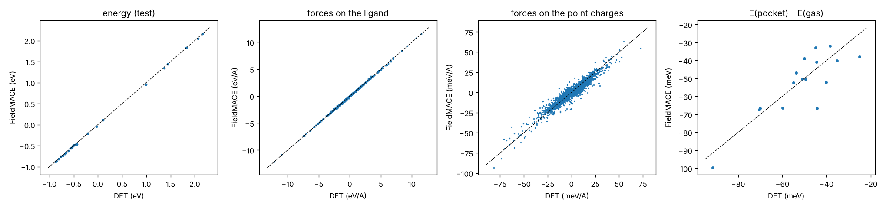
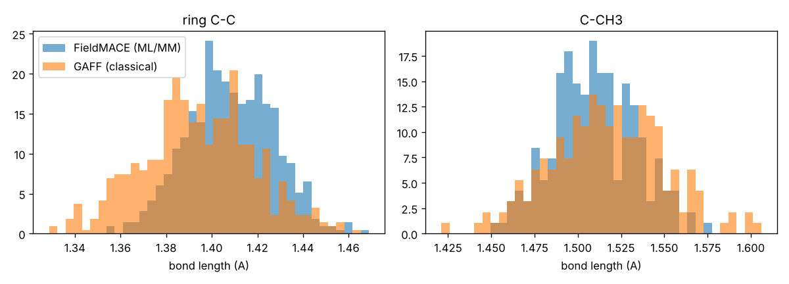

# Tutorial 06: a ligand in a protein pocket

*Author: Rhyan Barrett*

A complete ML/MM workflow for a drug-like situation: a ligand bound in a protein, in explicit water.
The ligand is described by FieldMACE, trained on DFT in the field of the protein, water and ions.
Everything else is the Amber14/TIP3P force field.

**System.** p-xylene bound in the engineered hydrophobic cavity of T4 lysozyme L99A, a classic
test system for binding, solvated in a truncated octahedron of TIP3P water with counter-ions:
27 835 atoms. The complex and the ligand's GAFF parameters ship with openmmtools.
**QM region.** The 18 ligand atoms (no covalent bond to the protein, so no link atoms).
**Embedding.** All ~700 protein, water and ion charges within 12 Å of the ligand centre, switched off
smoothly between 10 and 12 Å.
**Reference.** PBE/def2-SVP (density fitting) in PySCF, with the point charges.

```
01_prepare_system.py         -> work/system_classical.xml, work/equilibrated.pdb, work/setup.json
02_sample_configurations.py  -> work/frames.xyz          (classical MD, 40 ps)
03_label_with_pyscf.py       -> data/train.xyz, data/test.xyz   (shipped as data/*.xyz.gz)
04_train.sh                  -> models/pxylene_pocket.model
05_evaluate.py               -> error table, results/parity_pocket.png
06_mlmm_md.py                -> ML/MM MD in OpenMM, energy conservation, ligand geometry vs GAFF
```

Needs: `pip install -e ".[mlmm,test]"` (OpenMM, openmmtools), PySCF for new labels. The labelled data
are shipped, so steps 2–3 are optional: run step 1 (a few minutes), then 4–6.

---

## Step 1: the system

```bash
python 01_prepare_system.py
```

Setting up a protein–ligand system is usually the hardest part. The protein and water come from
OpenMM's Amber14 XML files. The ligand needs its own parameters; here they are GAFF parameters from a
`ligand.prmtop` made with antechamber/tleap. The script turns them into something OpenMM's
`ForceField` can use:

1. a small XML file for the ligand residue, with one atom type per atom and its GAFF charge and LJ
   parameters. With it, `Modeller.addSolvent` and `ForceField.createSystem` handle the ligand like any
   other residue;
2. the ligand's bonds, angles and torsions (including impropers), copied atom by atom from
   `ligand.prmtop` into the new system.

The script checks that the ligand's energy is the same as in `ligand.prmtop` (to 10⁻⁴ kJ/mol). The same
recipe works for any ligand with Amber parameters. With openmmforcefields (GAFF or OpenFF template
generators), build the system directly instead. Every other input that `mace.mlmm.io.load_system`
reads works too: Amber, GROMACS, CHARMM, or a serialized `system.xml`.

Then: solvate (1 nm padding, truncated octahedron, neutralised), minimise, and equilibrate for 50 ps
while the restraints on the protein heavy atoms are released step by step.

`setup.json` stores the QM atoms and the embedding. Training data and ML/MM MD both use it.

## Step 2: sampling

```bash
python 02_sample_configurations.py            # 160 frames, one every 0.25 ps
```

Classical MD at 300 K. Each frame holds the ligand and the charges within 12 Å, already switched
(`frame_to_atoms` with the embedding of `setup.json`). Every second frame has its ligand atoms
displaced at random (σ = 0.03 or 0.06 Å). The ML/MM dynamics will visit DFT-quality geometries that
the GAFF trajectory does not, so the data must cover them.

## Step 3: labels

```bash
python 03_label_with_pyscf.py                 # PBE/def2-SVP, ~30 s per frame on 2 cores
python 03_label_with_pyscf.py --xc b3lyp --basis 6-31g* --no-density-fit   # slower, ~3x
```

Each label holds the energy (including the interaction with the charges), forces on the ligand and
forces on every point charge. 10% of the frames are also labelled in the gas phase, so the model
learns the bare ligand and, by difference, the effect of the pocket. The job can be stopped and
restarted (`work/partial.xyz`). On a cluster, split it with `--start`/`--stop`, or use the
active-learning loop of tutorial 03 with `labeller: external`.

## Step 4: training

```bash
bash 04_train.sh                              # CPU, ~30 min
DEVICE=cuda EPOCHS=500 CHANNELS=64 bash 04_train.sh
```

`PerAtomFieldEMACE` with multipoles up to ℓ = 2 (`--multipole_max_ell=2`). A protein pocket's
field is far from uniform across a ligand, so the per-atom expansion and the quadrupoles matter.
Each frame has ~700 point-charge forces, which carry a lot of information about how the ligand
responds to the field (`--mm_forces_weight`).

## Step 5: evaluation

```bash
python 05_evaluate.py
```

```
test set: 24 frames
  energy        MAE   0.72 meV/atom (13.0 meV per frame)
  ligand forces MAE   28.2 meV/A
  MM forces     MAE   0.46 meV/A (mean |F| 1.2)
  interaction with the pocket, E(pocket) - E(gas), 16 frames: DFT -51 +- 15 meV, model MAE 7.4 meV
```



(CPU defaults: 32 channels, 150 epochs, ~25 min.)

The last panel is the interaction of the ligand with its surroundings, E(pocket) − E(gas), for the
16 frames labelled both ways (most of them in the training set). The model evaluates the same frame with
and without the point charges, and reproduces the frame-to-frame changes of this interaction (−25 to
−90 meV) to 7 meV. p-xylene is nonpolar and sits
in a hydrophobic pocket, so the interaction is small and comes mostly from the backbone dipoles and the
water near the pocket entrance. With a polar ligand or a charged active site it is larger, and the
same workflow applies.

## Step 6: ML/MM MD

```bash
python 06_mlmm_md.py                          # 2 ps NVT + 0.5 ps NVE, then 2 ps classical
python 06_mlmm_md.py --backend torch          # TorchForce (openmm-torch, conda-forge)
```

```
ML/MM NVT 1.0 ps (python backend, CPU): 157.3 ms/step                     (1 CPU thread, 27 835 atoms)
ML/MM NVE 0.25 ps: total energy std 2.49 kJ/mol, drift -19.9 kJ/mol/ps
ring C-C   ML/MM 1.4082 +- 0.0189 A, GAFF 1.3942 +- 0.0245 A
C-CH3      ML/MM 1.5097 +- 0.0237 A, GAFF 1.5167 +- 0.0325 A
```

(`python 06_mlmm_md.py --nvt-ps 1 --nve-ps 0.25`; the defaults run twice as long.)



* **What changes.** The ML/MM system is the classical one with the ligand's bonded terms and charges
  removed. FieldMACE gives the ligand's energy in the field, and the forces on the ~700 charges
  around it. The ligand–environment Lennard-Jones terms stay.
* **Bond lengths.** In the pocket, GAFF's aromatic ring is 0.014 Å tighter than PBE's, and its C–CH₃
  bond is slightly longer. The ML/MM ligand has the DFT geometry in the field of the pocket. The
  narrower ML/MM distributions partly reflect the shorter time step (0.5 fs against 2 fs) and
  the different equilibration of the two short runs.
* **Cost.** The ML part is small; most of the time is OpenMM's PME for 28 000 atoms on one CPU thread.
  On a GPU (CUDA platform) both are fast.
* **Time step.** C–H bonds of the ligand are flexible in ML/MM (0.5 fs), while the rest of the system
  keeps its constraints.

## Where to go from here

* **More data.** Run active learning on this system: copy `../03_openmm_mlmm_md/al.yaml` and point
  `system:` at `work/system_classical.xml` and `work/equilibrated.pdb`, `setup:` at `work/setup.json`,
  and `initial_data:` at `data/train.xyz`.
* **Bigger QM regions.** Add pocket side chains: pass their atoms with the ligand to
  `prepare_qmmm_system`. Hydrogen link atoms cap the cut bonds, as in tutorial 01.
* **Excited states of a chromophore in a protein.** Same set-up with the multi-state models of
  tutorials 02 and 05, and SHARC_QMMM with OpenMM for the dynamics.
